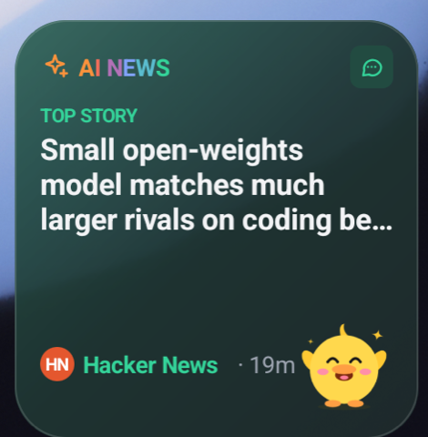
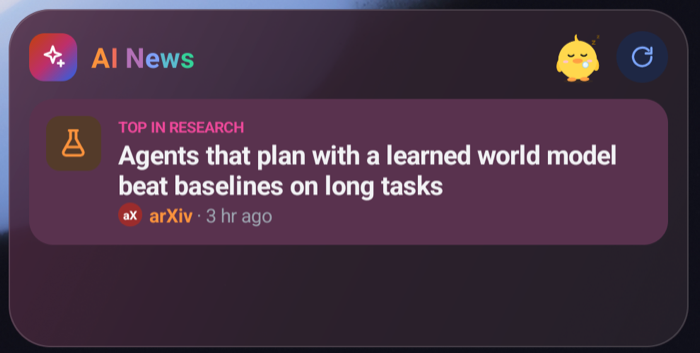
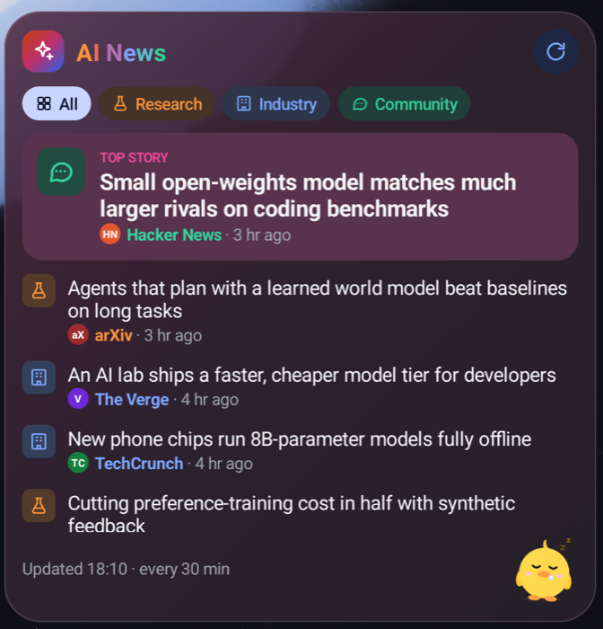
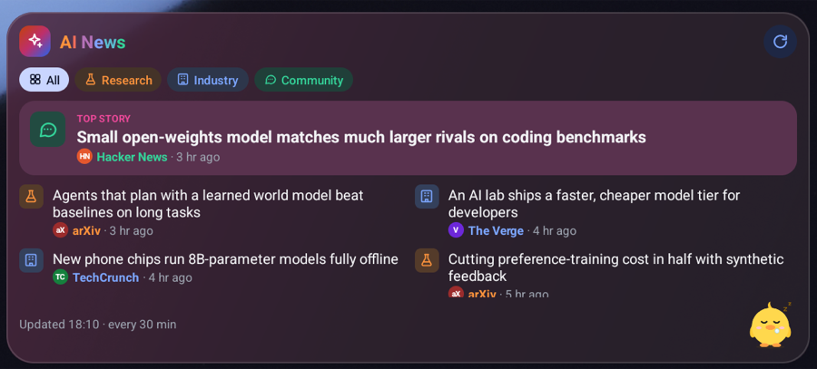
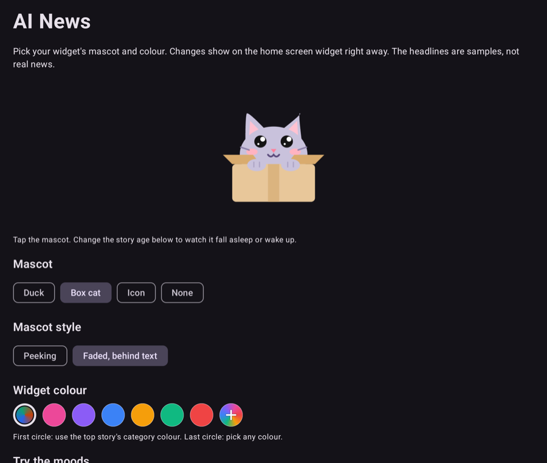

# AI News widget for Android

A home screen widget that shows the latest AI headlines, with a duck or a box cat that gets sleepier as the news gets older. It's made for the Galaxy Z Fold 8: compact on the cover screen, two columns on the big inner screen. It runs on any phone with Android 8.0 or later.

The widget is built with [Jetpack Glance](https://developer.android.com/develop/ui/compose/glance), and the small settings app with Jetpack Compose.

> **Sample headlines.** The stories are placeholders, not real news. See [Next steps](#next-steps) to connect a real feed.

<table>
  <tr>
    <td valign="top"><br><b>2 × 2</b>: the top story</td>
    <td valign="top"><br><b>4 × 2</b>: header and top story, here filtered to Research</td>
  </tr>
  <tr>
    <td valign="top"><br><b>4 × 4</b>: filter chips and the full list</td>
    <td valign="top"><br><b>8 × 4</b>: two columns on the open Fold</td>
  </tr>
</table>

<sub>Pixel Fold emulator, dark mode. The 2 × 2 uses the top story's category colour; the others use a custom pink.</sub>

## Features

- **Four sizes, one widget.** It picks a layout from how much room it has: the top story (2 × 2), a header and the top story (4 × 2), filter chips and a scrolling list (4 × 4), and two columns once it's wide enough (8 × 4 on the open Fold). Drag its edges and the layout follows.
- **Colour-coded categories.** Research, Industry and Community each have a colour and an icon. Filter chips show one category at a time.
- **A mascot with moods.** The duck or box cat is happy while the top story is under 30 minutes old, calm until 2 hours, then sleepy (the box cat climbs out of its box and curls up). The mood moves on by itself as the story ages.
- **Your style.** Choose the duck, the box cat, a faded category icon, or nothing. The mascot can peek from the corner or sit big and faded behind the text. The colour can follow the top story's category, use one of six presets, or be any colour you pick.
- **Light and dark mode.**
- **Refresh.** The widget redraws about every 30 minutes, or right away when you tap refresh.

### Animation

Home screen widgets can't run animations, so the widget's mascot flips through pre-drawn frames of its idle loop (hop, sway, peekaboo, breathing). The settings app shows the full animations: the idle loops, a short story when the mood changes (Bedtime, Good morning, Dozing off, Bubble pop), and a reaction when you tap the mascot.



## Build and run

### Requirements

- [Android Studio](https://developer.android.com/studio) (a recent version)
- **JDK 17 or 21 for Gradle.** This project uses Gradle 8.9, which doesn't run on JDK 25. If Gradle sync fails with a Java version error, go to **Settings > Build, Execution, Deployment > Build Tools > Gradle** and set **Gradle JDK** to 17 or 21.
- Android SDK Platform 35 (Android Studio offers to install it)

### In Android Studio

1. **File > Open** and choose this folder. Wait for Gradle sync to finish (the first time downloads a lot and can take several minutes).
2. Make a foldable emulator: **Tools > Device Manager > +**, pick a foldable phone (for example Pixel Fold or "7.6 Fold-in with outer display") and a recent system image. To make it look like a Z Fold 8, download Samsung's **Galaxy Z Fold8 emulator skin** from [developer.samsung.com/galaxy-emulator-skin](https://developer.samsung.com/galaxy-emulator-skin), unzip it, and choose it under **Show Advanced Settings > Custom skin definition**.
3. Press **Run**. The AI News settings app opens.
4. Add the widget: in the app, pick a size under **Widget size** and tap **Add … widget to home screen**. Or touch and hold the home screen, tap **Widgets**, and find **AI News**. Drag the widget's edges to resize it, and use the emulator's fold control to switch between the cover and inner screens.

The two-column layout appears once the widget is about 460 dp wide. The Pixel Fold emulator's open home screen is two 4-column pages, so the widget can't get that wide there.

### From the command line

```sh
./gradlew assembleDebug
adb install -r app/build/outputs/apk/debug/app-debug.apk
```

## Changing the widget

Open the **AI News** app, or touch and hold the widget and tap its settings button. You can:

- choose the mascot: **Duck**, **Box cat**, **Icon** (a faded category icon) or **None**
- choose the mascot style: **Peeking** or **Faded, behind text**
- choose the colour: the top story's category colour, a preset, or **+** to pick any colour
- try the moods: make the top story look 12 minutes, 45 minutes or 3 hours old

Changes show on the widget right away.

## Project layout

| Path | What it is |
|---|---|
| `app/src/main/java/com/benbo/ainews/widget/NewsWidget.kt` | The widget: layouts for each size, filter chips, refresh |
| `app/src/main/java/com/benbo/ainews/widget/MascotFrames.kt` | The frames the widget flips through for each mascot and mood |
| `app/src/main/java/com/benbo/ainews/MainActivity.kt` | The settings app, also opened from the widget's settings button |
| `app/src/main/java/com/benbo/ainews/MascotStage.kt` | The animated mascot in the app (draws the SVGs in a WebView, using `app/src/main/assets/stage/mascot.html`) |
| `app/src/main/java/com/benbo/ainews/data/News.kt` | Sample headlines, categories and moods |
| `app/src/main/java/com/benbo/ainews/data/Prefs.kt` | Settings shared by the app and the widget |
| `assets/mascots/` | The mascot SVGs and their style guide |
| `app/src/main/res/drawable-nodpi/` | PNG copies of the mascots and their animation frames, for the widget |
| `HTML/` | Interactive design preview (see below) |
| `tools/export_mascots.md` | How to update the mascot PNGs |

## Design preview

`HTML/index.html` is an interactive preview of the design, showing the widget on an iPhone Duo and a Galaxy Z Fold 8. You can fold and unfold the phones, change sizes, and try the colours, mascots and moods. The iPhone widget is a separate project and isn't in this repo.

The page loads the mascot files with `fetch`, which most browsers block for local files, so serve the folder to see the mascots animate:

```sh
cd HTML
python3 -m http.server 8000
```

Then open <http://localhost:8000>.

## Mascots

The SVG files in `assets/mascots/` are the source of truth for the mascots. [`assets/mascots/README.md`](assets/mascots/README.md) has the style rules and the `data-part` labels that the animations use. The app packages this folder to draw the animated mascot.

The widget can't draw SVGs, so it uses PNG copies in `app/src/main/res/drawable-nodpi/`: the still pictures (see [`tools/export_mascots.md`](tools/export_mascots.md)) and the animation frames (`mframe_*` and the faded `mfaded_*`). If you change a mascot, re-export its PNGs and frames.

## Next steps

- **Real news:** replace `SampleNews.stories` in `data/News.kt` with your feed (for example a `news.json` file that a scheduled GitHub job writes), and fetch it in `RefreshAction` in `widget/NewsWidget.kt`.
- **Article links:** tapping a headline opens the settings app for now. Open the story's web page instead.
